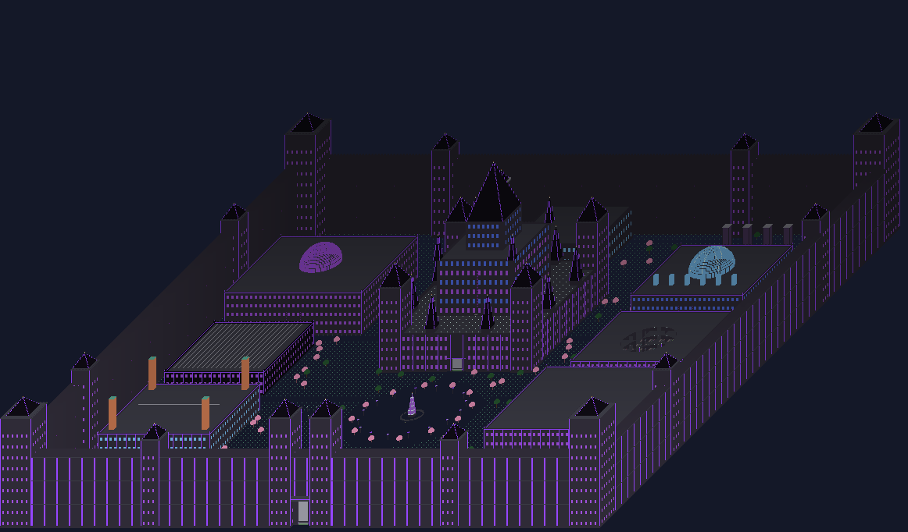

# RIFTBREK Vanguard Headquarters — master schematic + data pack

Minecraft Java **1.21.11**, Fabric + Litematica. Built to the concept render in `docs/concept/RIFTBREK_concept.png`.

| deliverable | file |
|---|---|
| ONE master schematic (768 × 384 × 768, world Y -64..319) | `dist/RIFTBREK_Vanguard_Headquarters_MASTER.litematic` |
| ONE data pack (format 94.1) | `dist/RIFTBREK_Vanguard_Datapack.zip` (source: `datapack/RIFTBREK_Vanguard_Datapack/`) |
| everything in one ZIP | `dist/RIFTBREK_Vanguard_FINAL_BUNDLE.zip` |
| install guide | `docs/INSTALL.md` |
| every command, numbered | `docs/COMMAND_HANDBOOK.md` |
| where every machine is | `docs/MODULE_INDEX.md` |
| what is tested / untested | `docs/TEST_REPORT.md`, `docs/TEST_RESULTS_AUTO.txt` |
| Wildezz builds recoloured purple + Airlander notes | `docs/ANNEX.md`, `dist/annex/*.litematic` |
| what is NOT built | `docs/KNOWN_GAPS.md` |
| credits | `docs/CREDITS.md` |



*(Preview rendered from the shipped .litematic by `tools/previews.py` — flat colours, not a Minecraft screenshot.)*

## Status in one paragraph (read this)

Nothing here has been run inside Minecraft — the build sandbox cannot download or start a game server. What *was* done: the old
datapack's real bugs were fixed (unparseable enchantment SNBT, no real redstone output from doors, books that could not carry
usernames, no player-usable commands, etc.), the schematic was rebuilt from scratch with real block entities (command blocks,
chests, hoppers, signs, dispensers) and then **statically** verified: block-support checks, geometry-vs-datapack offset checks,
walkability from outside the gate to every wing, the throne room, every sorter hall, vaults and the B1–B12 levels, and a scripted access-logic model test (doors, lockdown, revoke/restore, visitors, Veil privacy, kits) run against the real `.mcfunction` files. The
airship is an experimental data-pack vehicle, mob/iron output is command-driven, and a pure-redstone sorter is not built — see `docs/KNOWN_GAPS.md`. Expect to find and fix
in-game bugs; `docs/TEST_REPORT.md` has a 15-minute smoke-test checklist that finds them fastest.

## What the schematic contains (all real blocks, concept layout)

* 16-thick, 96-tall perimeter wall with parapet, patrol tunnels, 4 corner towers, 8 wall towers, south gatehouse with 12 command-block doors, Chunk Ban Square (safe simulation) behind it
* Royal Citadel (192×192, keep, 48-step grand ramp, **Throne Room** behind royal-tier doors, great spire), Central Plaza with crystal fountain
* Six faction wings: Archivist (Grand Archive), Unstables (dome + 4 wind-charge chicken chambers), Abstracters (arena), Veil, Wildcards, Storage Nexus
* Blimp terminal + 3 dock pads on the west lane; a **moving** Airlander 10 (your supplied ship as ~1,900 display entities; experimental, untested) started with `/function riftbrek:admin/blimp_on`
* Underground B1–B12: security, offices, 2-level Grand Archive, **2 sorter halls**, kit hall, industry (smelters, crafters, crop plots, shulker loaders/unloaders), B11 command-driven synthesis hall, transport (powered-rail ring + blue-ice highway), Veil HQ + secret tunnels, royal vaults, reserves
* 20 command-block door gates in 4 widths/tiers (public, member, leader, royal, 6 factions), lockdown-aware

## Rebuild / re-verify

```bash
tools/build_all.sh          # regenerates datapack + schematic, runs every check
python3 tools/model_test.py datapack/RIFTBREK_Vanguard_Datapack
```
